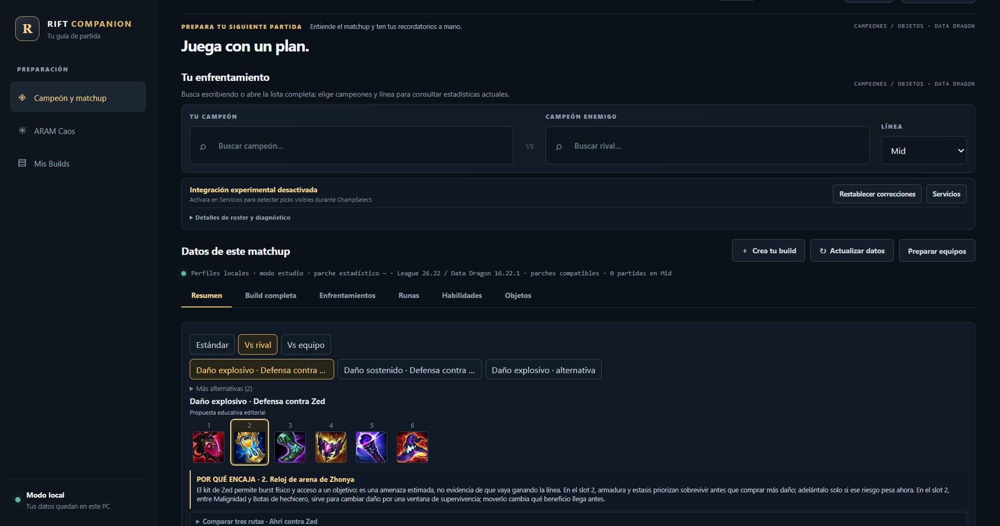
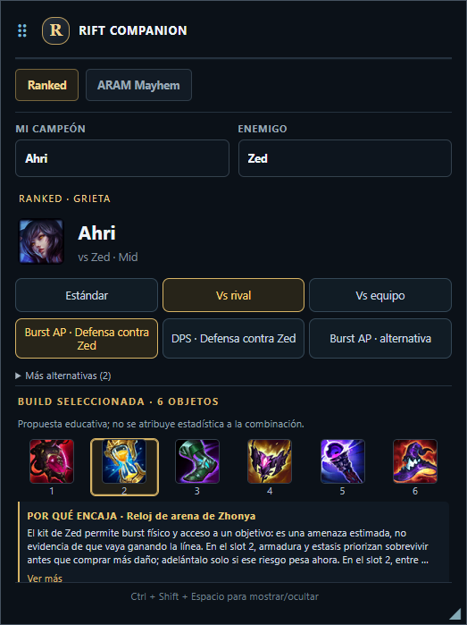

# Rift Companion

Rift Companion es una herramienta de escritorio gratuita y local para estudiar builds de League of Legends. Usa Electron estándar y permite comparar datos publicados con recomendaciones educativas identificadas por su procedencia. Es un proyecto personal, no comercial y no afiliado a Riot Games.

**English:** [README in English](README.md)





> Rift Companion no está avalada por Riot Games ni refleja las opiniones de Riot Games o de quienes producen o administran sus propiedades. Riot Games y las propiedades asociadas son marcas comerciales o marcas registradas de Riot Games, Inc.

## Funciones disponibles

- **Ranked / Grieta del Invocador:** elige campeón y rol sin abrir League. Revisa datos publicados de OP.GG cuando existan, perfiles locales curados, builds educativas de seis espacios, orden de compra, alternativas situacionales, runas, habilidades, enfrentamientos y explicaciones de objetos.
- **ARAM Mayhem, modo estudio:** consulta el snapshot incluido y atribuido, builds de objetos, alternativas, objetos situacionales, información de aumentos y explicaciones de sinergia.
- **Overlay:** ventana Electron independiente y controlada por el usuario, con secciones Ranked y ARAM Mayhem, búsqueda manual, tooltips y scroll. No intercepta Tab ni automatiza acciones del juego.
- **Preparación local:** adaptadores LCU / Live Client Data experimentales, de solo lectura y opcionales, además de edición manual de equipos. LCU no es una API oficialmente soportada para terceros.
- **Persistencia local:** guías, ajustes y cachés se guardan en el perfil local de Electron, sin una cuenta alojada por Rift Companion.

Las etiquetas **observada**, **curada**, **parcial** y **propuesta educativa** representan niveles de evidencia distintos. Una build generada no es una combinación estadística medida; su orden o puntuación no es un win rate.

### Cobertura Ranked

El conjunto de perfiles locales escritos para el proyecto contiene cinco pares campeón/rol: Ahri/MID, Malphite/TOP, Twitch/ADC, Sona/SUPPORT y Jinx/ADC. Actualmente están marcados como desactualizados respecto al catálogo 16.22.1, por lo que son provisionales y no cobertura verificada para el parche actual. El seed más amplio describe arquetipos candidatos; no es un catálogo de builds completas verificadas. Otras selecciones pueden usar datos publicados en línea o quedar parciales si falta evidencia. El repositorio no incluye snapshots de respuestas de OP.GG ni perfiles derivados.

### Estado de la detección de aumentos Mayhem

La detección automática sigue siendo un objetivo, pero no se ha confirmado una fuente local que identifique el aumento seleccionado por el jugador. Live Client Data respondió durante una partida real de Mayhem; el payload observado no identificó inequívocamente la selección. Se conserva el contrato neutral de eventos y el modo estudio separado, mientras que la adaptación automática en vivo está desactivada. El prototipo aislado de Overwolf es solo investigación y no forma parte del producto ni existe un plan de migración.

## Requisitos

- Windows 10/11 (la app y las integraciones locales actuales están orientadas a Windows).
- Node.js **22.12 o posterior** y npm. `package-lock.json` fija Electron en **45.2.1**.
- Internet para obtener recursos recientes de Data Dragon y consultar OP.GG. Los datos estáticos incluidos y las guías locales siguen disponibles offline en las funciones que tienen datos locales.

El flujo normal de estudio no requiere servicios pagos, suscripción, anuncios, clave de Riot ni App Store.

## Instalar y ejecutar

```powershell
git clone <url-del-repositorio>
cd rift-companion
npm ci
npm start
```

`npm ci` instala la versión exacta de dependencias fijada por el lockfile. También puedes usar `npm install` durante el desarrollo.

### Clave opcional de Riot Web API

La mayoría de funciones no necesita clave. Data Dragon, el MCP público de OP.GG, perfiles locales, el snapshot de ARAM y el modo de estudio normal no usan `RIOT_API_KEY`. El diagnóstico opcional de Riot y la consulta del historial propio usan endpoints oficiales de Riot Web API y requieren una clave de desarrollador. Configúrala localmente:

```powershell
Copy-Item .env.example .env.local
notepad .env.local
```

Define `RIOT_API_KEY=...` en `.env.local` o como variable de entorno del proceso principal de Electron. Nunca la subas a Git ni la incluyas en issues, capturas o logs. `.env.local` está ignorado por Git. LCU y Live Client Data son interfaces locales y no usan esta clave web.

## Comprobaciones de desarrollo

```powershell
npm run check
npm test
npm run validate:data
npm run validate:aram-mayhem
npm run test:electron
npm run test:ci
```

`npm run test:ci` ejecuta las comprobaciones compatibles con modo offline sin cargar claves Riot ni `.env.local`, y regenera las capturas con fixtures. La suite principal usa fixtures sintéticos propios y no debería omitir pruebas. `npm run test:opgg:integration` es una suite opcional separada que requiere archivos de auditoría OP.GG locales e ignorados por Git; no se ejecuta con `npm test` y esos archivos no deben publicarse.

`npm run capture:readme-screenshots` regenera las capturas usando fixtures locales. El capturador bloquea solicitudes de red salvo recursos estáticos de campeones/objetos/aumentos; las imágenes no contienen información de cuenta ni de partidas reales.

`npm run test:electron` ejecuta smoke tests locales de Electron con fixtures. No valida una selección activa real, eventos reales de aumentos, posición del overlay durante una partida ni aprobación de Riot. `npm run diagnose:mayhem-local:watch` diagnostica rutas LCDA documentadas y sanitizadas; las observaciones actuales no identificaron selecciones de aumentos.

## Arquitectura

```text
Proceso principal de Electron
  ├─ IPC seguro y puente preload
  ├─ persistencia y cachés locales
  ├─ clientes Data Dragon / OP.GG opcional / Riot Web API opcional
  ├─ validador Ranked, ranking y motor educativo de builds
  ├─ catálogo Mayhem, adaptador de builds y evaluador de sinergias
  └─ adaptadores experimentales de solo lectura LCU / Live Client Data

Ventanas renderer
  ├─ interfaz principal de estudio
  ├─ overlay bajo control del usuario
  └─ ventana separada de tooltip de objetos/aumentos
```

El contrato neutral de eventos Mayhem no depende de un proveedor. No hay un proveedor de aumentos en vivo habilitado. La prueba Overwolf está aislada en `src/experimental/overwolf-aram/` y no debe considerarse una integración aprobada o funcional.

## Fuentes y licencias de datos

Consulta [Fuentes de datos y avisos](docs/DATA_SOURCES.md) y [avisos de terceros](THIRD_PARTY_NOTICES.md) antes de copiar o redistribuir datos o recursos.

- **Riot Data Dragon:** JSON estático de versiones fijadas; las imágenes se solicitan al CDN de Riot. Los datos y la propiedad intelectual de Riot no están bajo la licencia del código fuente de este repositorio. Conserva atribución y aviso de no afiliación; revisa las políticas actuales antes de redistribuir.
- **OP.GG MCP:** fuente remota pública opcional para datos agregados Ranked. Se consulta bajo demanda y se cachea localmente. No requiere clave de Riot. Los snapshots de respuestas OP.GG y reportes que incorporan datos de la fuente se excluyen hasta confirmar sus términos de redistribución.
- **ARAM Mayhem:** el snapshot incluido declara CC BY 4.0. Atribución requerida: **Data: arammayhem.com** con enlace. El parche y la cobertura están en sus metadatos. No se muestran intencionalmente win rates de aumentos.
- **Meraki Analytics:** adaptador opcional de conocimiento de campeones. El repositorio upstream identifica MIT para su código y solicita atribución a Meraki y League of Legends Wiki; el contenido de habilidades tiene procedencia separada. La app no incluye un snapshot de respuestas Meraki.
- **CommunityDragon:** su adaptador está desactivado para ingesta; no se incluye un dataset extraído de CommunityDragon.
- **Electron y paquetes npm transitivos:** el lockfile usa paquetes públicos de npm. Antes de redistribuir un binario, revisa los avisos de licencia de cada paquete.

Todavía no se incluye una licencia única para todo el repositorio. Código, contenido derivado de Riot y el snapshot CC BY tienen términos diferentes; consulta la auditoría antes de proponer una licencia o publicar.

## Hoja de ruta

1. Completar la revisión de seguridad y procedencia para GitHub, especialmente el historial Git local no disponible y los snapshots de OP.GG.
2. Mejorar la cobertura y calidad del modo de estudio Ranked con procedencia explícita.
3. Mantener separado el estudio de Mayhem de la automatización durante partidas.
4. Retomar la adaptación automática de aumentos solo si existe una fuente permitida y confirmada, compatible con las políticas de Riot.
5. Mantener Electron estándar; no hay migración a Overwolf planificada.

## Limitaciones conocidas

- OP.GG requiere conexión y puede no publicar datos para cierto rol, parche o campeón.
- La versión Data Dragon y el parche regional del cliente pueden diferir; la app informa procedencia cuando está disponible.
- Perfiles locales y sugerencias educativas no garantizan una build óptima.
- LCU es una interfaz local experimental, no una API oficialmente soportada para terceros.
- La detección automática de aumentos Mayhem **no está implementada** porque no se observó una señal local permitida y confirmada.
- Las políticas actuales de Riot requieren registrar productos destinados a jugadores y limitan información de sesión y recomendaciones que dicten decisiones. Una publicación pública requiere revisar cumplimiento por separado.

## Contribuir

Consulta [CONTRIBUTING.md](CONTRIBUTING.md). Las contribuciones deben incluir pruebas reproducibles y procedencia/parche de conocimiento del juego. No añadas secretos, cachés personales, snapshots OP.GG no publicados, datos ocultos de rivales ni automatización dentro del juego.
