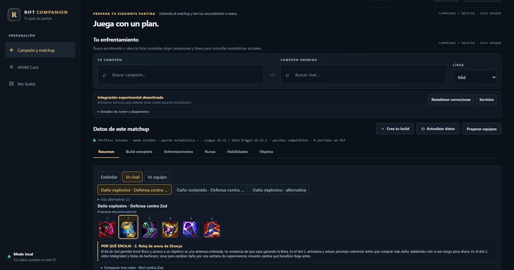
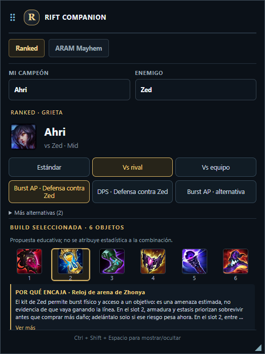

# Rift Companion

Rift Companion is a free, local-first desktop study tool for League of Legends builds. It uses standard Electron and helps players compare published build data with clearly labeled educational recommendations. The project is personal, non-commercial, and not affiliated with Riot Games.

**Spanish:** [README en español](README.es.md)





> Rift Companion is not endorsed by Riot Games and does not reflect the views or opinions of Riot Games or anyone officially involved in producing or managing Riot Games properties. Riot Games and all associated properties are trademarks or registered trademarks of Riot Games, Inc.

## What works today

- **Ranked / Summoner's Rift study mode:** choose a champion and role without opening League; review published OP.GG data when available, local curated profiles, six-slot educational builds, purchase order, situational choices, runes, skill order, matchup guidance, and item explanations.
- **ARAM Mayhem study mode:** browse the bundled, attributed Mayhem snapshot, champion item builds, alternatives, situational items, augment information, and augment synergy explanations.
- **Overlay:** a separate, user-controlled Electron window with Ranked and ARAM Mayhem sections, manual champion search, item/augment tooltips, and scrolling. It does not intercept Tab or automate in-game actions.
- **Local preparation:** optional, experimental, read-only LCU / Live Client Data adapters and manual roster editing. LCU is not an officially supported third-party API; keep this feature opt-in.
- **Local persistence:** guides, settings, and source-response caches live in the Electron user-data directory, not in a hosted Rift Companion account.

Builds labeled **observed**, **curated**, **partial**, or **educational proposal** have different evidence. A generated proposal is not a measured statistical combination; do not interpret its order or fit score as a win rate.

### Ranked coverage

The local authored profile set contains five champion/role pairs: Ahri/MID, Malphite/TOP, Twitch/ADC, Sona/SUPPORT, and Jinx/ADC. These profiles are currently marked stale relative to the bundled 16.22.1 catalog, so they are provisional rather than current-patch-verified coverage. The larger champion-role seed describes candidate archetypes; it is not a verified full-build catalog. Other choices can use live published data when available, or remain partial when evidence is insufficient. The repository does not bundle OP.GG response snapshots or derived pilot profiles.

### Mayhem augment detection status

The automatic objective remains open, but no confirmed local source currently identifies the player's selected Mayhem augment. Live Client Data responded during a real Mayhem game, but the observed payload did not contain an unambiguous augment selection. The neutral event contract and separate study mode are retained; automatic live adaptation is disabled. The isolated Overwolf prototype is research only and is not part of the product or a planned migration.

## Requirements

- Windows 10/11 (the current app and local League integrations are Windows-oriented).
- Node.js **22.12 or newer** and npm. Electron is locked to **45.2.1** by `package-lock.json`.
- Internet access for fresh Data Dragon assets and OP.GG requests. Bundled static data and local guides remain available offline where the selected feature has local data.

No paid service, subscription, advertising SDK, Riot API key, or app store is required for the normal study workflow.

## Install and run

```powershell
git clone <repository-url>
cd rift-companion
npm ci
npm start
```

For a reproducible install, use `npm ci`; it installs the exact dependency tree in the lockfile. `npm install` is also available for development.

### Optional Riot Web API key

Most features do **not** need a Riot key. Data Dragon, OP.GG's public MCP endpoint, local build profiles, ARAM snapshot browsing, and the normal study workflow do not use `RIOT_API_KEY`. The optional Riot account/service diagnostics and the user's own recent-match lookup use official Riot Web API endpoints and need a developer key. Configure it locally:

```powershell
Copy-Item .env.example .env.local
notepad .env.local
```

Set `RIOT_API_KEY=...` in `.env.local`, or set the environment variable for the Electron main process. Never commit, paste into an issue, or include the key in screenshots/logs. `.env.local` is ignored by Git. LCU and Live Client Data are local interfaces and do not use this Web API key.

## Development checks

```powershell
npm run check
npm test
npm run validate:data
npm run validate:aram-mayhem
npm run test:electron
npm run test:ci
```

`npm run test:ci` runs the offline-safe checks with Riot keys and local `.env.local` loading disabled, then regenerates the fixture screenshots. The main test suite uses project-authored synthetic source-shape fixtures and has no expected skipped tests. `npm run test:opgg:integration` is a separate, optional suite that requires locally available ignored OP.GG audit files; it does not run as part of `npm test` and those files must not be committed.

`npm run capture:readme-screenshots` regenerates the screenshots above using local fixture data; the capture harness blocks third-party network requests except static champion/item/augment art hosts. The images contain no account or live-game data.

`npm run test:electron` runs local Electron smoke checks with fixtures. These do not validate an active League draft, a real Mayhem augment event, in-game overlay positioning, or Riot approval. `npm run diagnose:mayhem-local:watch` is a bounded, sanitized diagnostic for documented LCDA routes only; current results did not identify augment selections.

## Architecture

```text
Electron main process
  ├─ secure IPC + preload bridge
  ├─ local persistence and source caches
  ├─ Data Dragon / optional OP.GG / optional Riot Web API clients
  ├─ Ranked build validation, ranking and educational recommendation engine
  ├─ ARAM Mayhem catalog, build adapter and augment synergy evaluator
  └─ optional experimental read-only LCU / Live Client Data adapters

Renderer windows
  ├─ main study interface
  ├─ user-controlled overlay
  └─ separate item/augment tooltip window
```

The neutral Mayhem event-session contract is provider-independent. There is no enabled live augment provider. The experimental Overwolf proof of concept is isolated under `src/experimental/overwolf-aram/` and must not be treated as an approved or functioning integration.

## Data sources and licensing

See [Data sources and notices](docs/DATA_SOURCES.md) and [third-party notices](THIRD_PARTY_NOTICES.md) before copying or redistributing any data/assets.

- **Riot Data Dragon:** bundled static JSON for the pinned dataset versions; images are requested from Riot's CDN. Riot's game data and IP are not licensed under this repository's source-code license. Keep Riot's attribution/non-affiliation notice and review current Riot policies before redistribution.
- **OP.GG MCP:** optional public remote source for Ranked aggregated build/matchup information. It is queried on demand and cached locally. No Riot key is required. Live OP.GG response snapshots and generated reports containing source data are excluded from the public repo until redistribution terms are confirmed.
- **ARAM Mayhem:** bundled snapshot data carries CC BY 4.0; required attribution is **Data: arammayhem.com** with a link. Snapshot coverage and patch are recorded in the data metadata. No augment win-rate data is intentionally shown.
- **Meraki Analytics:** an optional runtime champion-knowledge adapter. The upstream repository identifies MIT for its code and asks users to credit Meraki and the League of Legends Wiki; ability content provenance is separate. The app does not bundle a Meraki response snapshot.
- **CommunityDragon:** adapter is disabled for ingestion; no extracted CommunityDragon dataset is bundled.
- **Electron and transitive npm packages:** lockfile-resolved dependencies are public npm packages. Run `npm ls --all` and inspect each package notice before distributing a binary.

No final repository-wide source license is included yet. The source code, Riot-derived assets/data, and CC BY snapshot have different terms; see the readiness audit before proposing a license or publishing.

## Roadmap

1. Finish the GitHub security/provenance review, especially the unavailable local Git history and OP.GG response snapshots.
2. Keep Ranked mode-study quality and coverage improving with explicit provenance.
3. Keep Mayhem study content separate from live-play automation.
4. Revisit automatic augment adaptation only if a permitted, confirmed event source becomes available and the use is compatible with Riot policy.
5. Preserve the Electron app; no Overwolf migration is planned.

## Known limits

- OP.GG needs an internet connection and may omit data for a role, patch, or champion.
- Data Dragon version and live regional game patch can differ; the app reports patch provenance where available.
- Local build profiles and generated educational suggestions are not guarantees of optimal play.
- LCU is an experimental local interface, not an officially supported third-party API.
- Automatic Mayhem augment selection detection is **not implemented** because no confirmed allowed local signal was observed.
- Riot's current developer policies require registration of player-facing products and place restrictions on live-session information and decision-dictating recommendations. Public release needs a separate compliance review.

## Contributing

See [CONTRIBUTING.md](CONTRIBUTING.md). Contributions should include reproducible tests, source/patch provenance for game knowledge, and must not add secrets, personal caches, unpublished OP.GG data, hidden-opponent data, or in-game automation.
